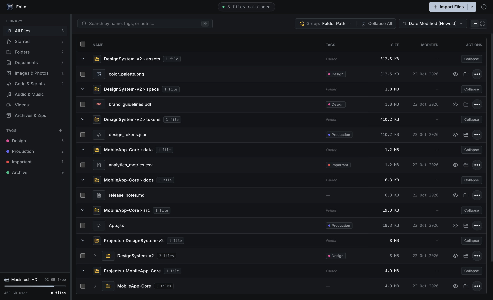
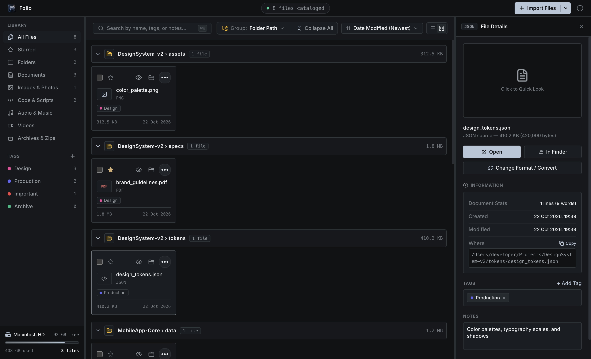
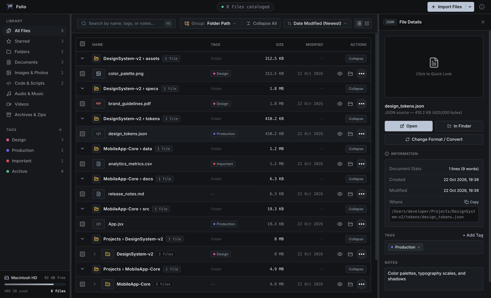
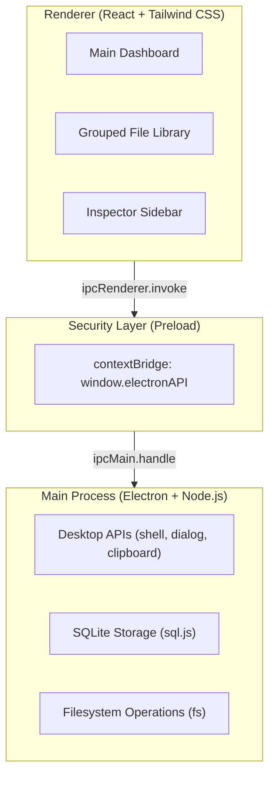

# Folio

### Desktop File & Media Tagging Organizer

<p align="center">
  
</p>

<p align="center">
  <strong>A modern, local-first desktop workspace to catalog, organize, tag, and inspect your files.</strong>
</p>

<p align="center">
  
  
  
  
  
  
</p>

<p align="center">
  <a href="https://github.com/mausam-005/Folio/releases/latest">
    
  </a>
  <a href="https://github.com/mausam-005/Folio">
    
  </a>
</p>

<p align="center">
  <sub>Apple Silicon · macOS · Open Source</sub>
</p>

---

## Workspace Preview

<p align="center">
  
</p>

<table width="100%">
  <tr>
    <td width="50%" align="center" valign="top">
      
      <br />
      <sub><strong>Library View</strong> with category badges and tag filters</sub>
    </td>
    <td width="50%" align="center" valign="top">
      
      <br />
      <sub><strong>Inspector Sidebar</strong> with file metadata, color tags, and format conversion</sub>
    </td>
  </tr>
</table>

---

## Highlights

- **Intelligent Grouping:** Group files by folder hierarchy, file categories, or modification date.
- **Tagging & Filtering:** Create custom color-coded tags, mark favorites, and search using multiple keywords.
- **Native Desktop Access:** Reveal files in Finder, open them in their default applications, and import using OS drag-and-drop.
- **File Inspector:** Inspect file metadata, word and line counts, and supported format conversion options.
- **Local-First & Fast:** Keep catalog data locally with SQLite, without requiring a cloud service.

---

## Architecture

Folio isolates privileged Node.js desktop interactions from the React interface using Electron's context bridge.



---

## Getting Started

### Download for macOS

<p align="center">
  <a href="https://github.com/mausam-005/Folio/releases/latest">
    
  </a>
</p>

1. Open the [**latest Folio release**](https://github.com/mausam-005/Folio/releases/latest).
2. Download the `.dmg` installer from the release assets.
3. Open the downloaded disk image.
4. Drag **Folio** into your `Applications` folder.
5. Launch Folio from Applications.

> **Compatibility:** Choose the installer that matches your Mac's processor. Use the Apple Silicon build for M-series Macs. A downloadable installer must be attached to the GitHub release for this process to work.

### Run from Source

#### Prerequisites

- [Node.js](https://nodejs.org/) `v18.0.0` or higher
- npm `v9.0.0` or higher
- Git

#### Quick Start

```bash
git clone https://github.com/mausam-005/Folio.git
cd Folio
npm install
npm run dev
```

#### Step-by-Step Installation

```bash
# 1. Clone the repository
git clone https://github.com/mausam-005/Folio.git

# 2. Navigate to the project directory
cd Folio

# 3. Install dependencies
npm install

# 4. Launch Vite and Electron
npm run dev
```

### Build a macOS Installer

```bash
npm run dist:mac
```

If configured in `package.json`, this command generates the macOS installer in the `release/` directory. The actual output filename depends on the Electron packaging configuration.

---

## Desktop APIs & System Capabilities

| Desktop API | How It Is Used in Folio |
|---|---|
| `shell.showItemInFolder()` | Reveals and highlights the selected file in Finder or File Explorer. |
| `shell.openPath()` | Opens files in their default system applications, such as Preview or VS Code. |
| `dialog.showOpenDialog()` | Opens native dialogs for selecting files and folders. |
| OS Drag & Drop | Imports files and directories dropped from desktop folders. |
| `clipboard.writeText()` | Copies absolute file paths to the clipboard. |
| `Notification` API | Displays native desktop notifications for supported operations. |
| Filesystem APIs (`fs`) | Reads file metadata and handles supported file operations. |
| Frameless Window | Provides custom titlebar controls and window-state synchronization. |

---

## Project Structure

```text
Folio/
├── electron/
│   ├── database.cjs          # SQLite data management and catalog queries
│   ├── main.cjs              # Electron main process and OS IPC handlers
│   └── preload.cjs            # Context-isolated IPC bridge
├── public/
│   ├── app_icon.png           # Application icon
│   ├── Folio_icon_dock.png    # Dock and window icon
│   ├── icon.icns              # macOS application icon
│   └── screenshots/
│       ├── dashboard.png
│       ├── file-library.png
│       └── file-details.png
├── src/
│   ├── components/
│   │   ├── AboutModal.jsx
│   │   ├── ConfirmModal.jsx
│   │   ├── DropZone.jsx
│   │   ├── FileDetail.jsx
│   │   ├── FileList.jsx
│   │   ├── FormatModal.jsx
│   │   ├── QuickPreview.jsx
│   │   ├── Sidebar.jsx
│   │   ├── SplashScreen.jsx
│   │   ├── TagModal.jsx
│   │   └── Titlebar.jsx
│   ├── utils/
│   │   └── url.js
│   ├── api.js                 # Unified API client
│   ├── App.jsx                # Main workspace coordinator
│   ├── index.css              # Global styles and design system
│   └── main.jsx               # React entry point
├── index.html
├── package.json
├── package-lock.json
├── postcss.config.cjs
├── tailwind.config.js
├── vite.config.js
├── .gitignore
└── README.md
```

---

<details>
  <summary><strong>Technical Reference: IPC Channels & Database Schema</strong></summary>

### IPC Channels

**Window Controls**

- `window:minimize`
- `window:maximize`
- `window:close`
- `window:isMaximized`
- `window:isFullScreen`

**Operating System & Filesystem**

- `os:openPath`
- `os:revealInFinder`
- `os:copyToClipboard`
- `os:selectFilesDialog`
- `os:selectFolderDialog`
- `os:showNotification`
- `os:readTextPreview`
- `os:getFileStats`
- `os:changeFormat`
- `os:getDiskSpace`

**Database Operations**

- `db:getFiles`
- `db:addFiles`
- `db:deleteFile`
- `db:deleteFiles`
- `db:toggleFavorite`
- `db:updateNotes`
- `db:getTags`
- `db:createTag`
- `db:deleteTag`
- `db:attachTag`
- `db:detachTag`
- `db:attachTagToMultiple`
- `db:getStats`

### SQLite Schema

```sql
CREATE TABLE IF NOT EXISTS files (
    id INTEGER PRIMARY KEY AUTOINCREMENT,
    name TEXT NOT NULL,
    path TEXT UNIQUE NOT NULL,
    size INTEGER NOT NULL,
    extension TEXT NOT NULL,
    category TEXT NOT NULL,
    is_favorite INTEGER DEFAULT 0,
    notes TEXT DEFAULT '',
    created_at DATETIME DEFAULT CURRENT_TIMESTAMP,
    updated_at DATETIME DEFAULT CURRENT_TIMESTAMP
);

CREATE TABLE IF NOT EXISTS tags (
    id INTEGER PRIMARY KEY AUTOINCREMENT,
    name TEXT UNIQUE NOT NULL,
    color TEXT NOT NULL,
    created_at DATETIME DEFAULT CURRENT_TIMESTAMP
);

CREATE TABLE IF NOT EXISTS file_tags (
    file_id INTEGER NOT NULL,
    tag_id INTEGER NOT NULL,
    PRIMARY KEY (file_id, tag_id),
    FOREIGN KEY (file_id) REFERENCES files(id) ON DELETE CASCADE,
    FOREIGN KEY (tag_id) REFERENCES tags(id) ON DELETE CASCADE
);
```

The `file_tags` table implements a many-to-many relationship between files and tags.

</details>

---

## License

MIT — [Mausam](https://github.com/mausam-005)